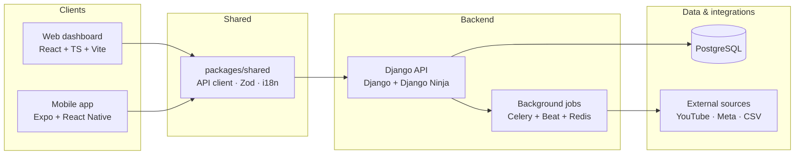

# Church Analytics App – Architecture

One Django API serves both the web dashboard and the mobile app.



## Clients

**Web dashboard** (`web/`): heavier admin work, such as donation entry, CSV imports, member and role management, reports, and connecting social accounts.
- React + TypeScript + Vite
- TanStack Query (server data), TanStack Router or React Router
- Tailwind CSS + shadcn/ui
- Recharts (charts), TanStack Table (data tables)
- react-i18next (English now; Spanish later)

**Mobile app** (`mobile/`): quick Sunday tasks, such as headcount entry per service, a glanceable dashboard, social stats, and push reminders.
- Expo + React Native + TypeScript
- Expo Router, NativeWind
- react-native-gifted-charts
- expo-secure-store (JWT storage), expo-notifications
- i18next + expo-localization (English now; Spanish later)

## Shared code (`packages/shared/`)

- pnpm workspaces monorepo
- Typed API client generated from the backend's OpenAPI schema
- Zod validation schemas
- Translation files: `en.json` (`es.json` added later)

## Backend (`backend/`)

**Django API**
- Django + Django Ninja
- JWT auth, roles (pastor/admin, treasurer, staff, volunteer)
- Multi-tenancy: every tenant-owned table has `church_id`, enforced in one place, with Postgres Row-Level Security as a second layer
- Audit log on giving records
- Django i18n (emails, reports, API errors), WeasyPrint (PDF reports)
- pytest-django, Ruff

**Background jobs**
- Celery + Celery Beat, Redis broker
- Daily social media stats sync (saved as snapshots so trends can be charted)

## Data & integrations

**PostgreSQL**: Row-Level Security, materialized views for dashboards, window functions for growth and year-over-year comparisons.

**External sources**
- YouTube Data + Analytics APIs
- Meta Graph API (Facebook / Instagram), stretch goal
- CSV giving imports (Tithe.ly, Planning Center exports)

The app records giving but does not process payments.

## DevOps & hosting

| Area | Tool |
|---|---|
| Local dev | Docker Compose |
| CI | GitHub Actions: lint, tests, type checks |
| API + DB + Redis | Render or Railway |
| Web + mobile | Vercel · EAS Build |
| Monitoring | Sentry |

## Repo layout

```
church-analytics/
├── backend/          # Django + Django Ninja
├── web/              # React + Vite
├── mobile/           # Expo React Native
└── packages/shared/  # API client, TS types, i18n JSON
```
